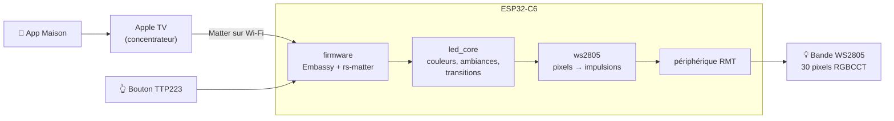

# project-led

**Une lampe barre connectée, façon Philips Hue, entièrement en Rust.**

Une bande LED **RGB + blanc chaud + blanc froid** glissée dans un tube acrylique, pilotée par un **ESP32-C6**. La lampe apparaît directement dans l'app **Maison** de l'iPhone grâce à **Matter**, sans pont ni app propriétaire. Chaque pixel est adressable, ce qui permet des dégradés et des animations.


> **Statut :** le firmware est écrit et compile, la partie indépendante du matériel est testée sur Mac. Les premiers essais sur la vraie carte arrivent dès réception du matériel.

## Fonctionnalités

| | Fonctionnalité | Détail |
|---|---|---|
| 🏠 | **App Maison native** | Lampe Matter (*Extended Color Light*), appairée par QR code via Bluetooth ; l'iPhone lui transmet le Wi-Fi. |
| 🎨 | **Couleurs et blancs** | Luminosité, teinte et saturation, température de blanc de 2700 K à 6500 K, grâce aux deux LED blanches. |
| 🌅 | **Ambiances** | *Coucher de soleil*, *Aurore boréale*, *Feu de camp* : des dégradés et animations pixel par pixel, chacun pilotable comme un interrupteur dans l'app Maison (scènes, automatisations, Siri). |
| ✨ | **Transitions douces** | Fondus à l'allumage, entre deux couleurs et entre deux ambiances ; correction gamma. |
| 💾 | **Mémoire** | L'appairage et le dernier état sont gardés en flash : la lampe revient comme elle était après une coupure. |
| 👆 | **Bouton tactile** | Un appui allume ou éteint la lampe (l'app suit). Maintenu au démarrage, il efface l'appairage. |
| 🚦 | **Signaux d'état** | Vague rouge en attente d'appairage, bleue pendant la connexion au Wi-Fi, pixel qui clignote si le Wi-Fi est perdu. |

## Comment ça marche



Le code est découpé pour que tout ce qui ne dépend pas du matériel soit **testable sur un ordinateur** :

| Crate | Rôle | Cible |
|---|---|---|
| [`led_core`](crates/core) | Couleurs (RGB, HSV), températures de blanc, transitions, état de la lampe, effets, ambiances et signaux d'état. | `no_std`, testé sur Mac |
| [`ws2805`](crates/ws2805) | Encodage des pixels de la bande WS2805 (5 canaux) en impulsions. | `no_std`, testé sur Mac |
| [`firmware`](crates/firmware) | Le programme de la puce : tâches Embassy, pile Matter, bande, bouton, sauvegarde en flash. | ESP32-C6 (`riscv32imac`) |

`led_core` et `ws2805` ne connaissent ni la puce ni Matter : ils pourront resservir à d'autres projets.

## Matériel

| Élément | Choix |
|---|---|
| Microcontrôleur | ESP32-C6 (carte de dev Waveshare ESP32-C6-DEV-KIT-N8) |
| Bande | WS2805 RGBCCT, 12 V, 60 LEDs/m, 1,5 m (30 pixels de 3 LEDs) |
| Alimentation | 12 V pour la bande, abaisseur vers 5 V pour la carte |
| Signal | Adaptateur de niveau 74AHCT125 (3,3 V → 5 V) |
| Bouton | Capteur tactile TTP223 (optionnel) |
| Concentrateur | Apple TV 4K |

Câblage, brochage et pièges à éviter : [HARDWARE.md](.claude/HARDWARE.md).

## Démarrer

Les tests de la partie indépendante du matériel tournent sur n'importe quel ordinateur avec Rust :

```bash
cargo test
```

Pour le firmware, il faut la cible RISC-V et `espflash`. Ensuite, carte branchée en USB :

```bash
cd crates/firmware
cargo run --release
```

Le guide complet est dans [docs/mise-en-route.md](docs/mise-en-route.md) : installation, flash de la carte, appairage avec l'app Maison, branchement de la bande.

## Documentation du projet

- [Feuille de route](.claude/ROADMAP.md) : où en est le projet, ce qui reste à tester, les idées pour la suite.
- [Décisions d'architecture](.claude/decisions/README.md) : chaque choix structurant, avec son contexte et ses alternatives (ADR).
- [Matériel](.claude/HARDWARE.md) : nomenclature, câblage, protocole de la bande.
- [Historique des changements](.claude/CHANGELOG.md).

## Pourquoi ce projet

C'est un projet personnel, qui sert aussi à **apprendre Rust** sur un vrai cas concret, de l'embarqué `no_std` jusqu'à Matter. Le code est volontairement commenté pour expliquer les concepts au fil de l'eau.

## Licence

Au choix, sous l'une de ces deux licences (comme la plupart des projets Rust) :

- [MIT](LICENSE-MIT)
- [Apache 2.0](LICENSE-APACHE)

Sauf mention contraire, toute contribution proposée à ce projet est publiée sous ces deux mêmes licences, sans condition supplémentaire.
